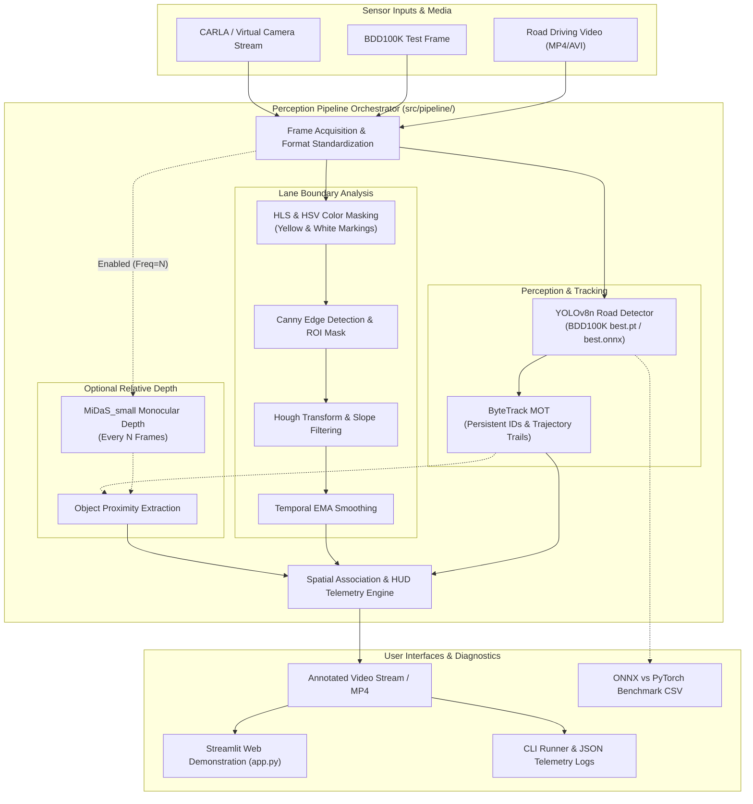

# Autonomous Driving Perception Stack — System Architecture

## 1. System Overview

The **Autonomous Driving Perception Stack** is a modular, high-throughput computer vision pipeline designed for road scene understanding. Built for reproducible execution on resource-constrained hardware (Windows 11 CPU / Intel Iris Xe graphics), the system processes continuous road driving video streams and performs:

1. **Pretrained Road Object Detection**: YOLOv8n fine-tuned on BDD100K across 10 vehicle, pedestrian, cyclist, and signage classes.
2. **Multi-Object Tracking (MOT)**: ByteTrack with trajectory trail history and persistent IDs across frames.
3. **Classical Lane Detection**: OpenCV HLS/HSV color thresholding, Canny edge detection, trapezoidal ROI filtering, Hough transform, and temporal smoothing.
4. **Monocular Relative Depth Estimation**: MiDaS_small depth estimation with explicit uncalibrated labeling and object proximity association.
5. **Unified Telemetry & Visualization**: Head-Up Display (HUD) overlay tracking latency, FPS, ego lane center offset, and active perception modules.
6. **Edge Deployment Benchmarking**: ONNX export and comparative evaluation of PyTorch vs. ONNX Runtime CPU execution.

---

## 2. End-to-End Architectural Data Flow

---

## 3. Component Breakdown & Responsibilities

### 3.1 Object Detection (`src/detection/`)
* **Class**: `RoadObjectDetector`
* **Model**: `dronefreak/bdd100k-yolov8n` (`best.pt`, 3.0M parameters, 5.98 MB).
* **Classes (10)**: `person`, `rider`, `car`, `truck`, `bus`, `train`, `motor`, `bike`, `traffic light`, `traffic sign`.
* **Execution**: Standardized CPU forward pass with configurable confidence and IoU thresholds.

### 3.2 Multi-Object Tracking (`src/tracking/`)
* **Class**: `RoadObjectTracker`
* **Algorithm**: ByteTrack with Linear Assignment Problem (LAP) association.
* **Feature**: Maintains persistent IDs across consecutive frames, calculates motion trajectories (`trail_history`), and avoids duplicate forward inference by executing detection and tracking simultaneously.

### 3.3 Lane Boundary & Corridor Detection (`src/lanes/`)
* **Class**: `OpenCVLaneDetector`
* **Approach**: Classical geometric vision completely independent of deep learning weights.
* **Steps**:
  1. HLS/HSV color thresholding isolating white and yellow pavement paint.
  2. Canny edge detector combined with trapezoidal Region-of-Interest (ROI) mask.
  3. Probabilistic Hough Transform (`cv2.HoughLinesP`).
  4. Slope gating (`0.35 < |slope| < 2.50`) rejecting horizontal pavement seams.
  5. Polynomial linear regression fitting and Exponential Moving Average (EMA) smoothing.
  6. Ego-vehicle lane departure and center offset calculation.

### 3.4 Deep Semantic Lane Segmentation (`src/lanes/`)
* **Class**: `SegmentationLaneDetector`
* **Architecture**: Torchvision LRASPP with MobileNetV3 Large backbone (12.5 MB).
* **Capability**: Dense pixel-level road corridor mask (class index 0/road) without explicit geometric straight-line assumptions. Captures curved ramps, complex intersections, and unpainted pavement boundaries.
* **Output**: `LaneDetectionResult` with `drivable_mask`, fitted contour polygon, center offset calculation, and latency telemetry.

### 3.5 Monocular Depth Estimation (`src/depth/`)
* **Class**: `MonocularDepthEstimator`
* **Model**: Intel ISL `MiDaS_small` on CPU.
* **Output Contract**: Normalized inverse relative proximity `[0.0, 1.0]`. Explicitly tagged with `is_calibrated_metric=False` and `label="Relative Proximity (Uncalibrated)"` to ensure scientific integrity without claiming unverified metric distances.

### 3.6 Simulation & Middleware Integration (`src/simulation/`)
* **`CARLASimulatorClient`**: Complete client lifecycle management (`connect`, `setup_sensor`, `start_streaming`, `stop`, `disconnect`), TCP port pre-validation, and thread-safe camera queue.
* **`CARLACameraAdapter`**: Translates CARLA's BGRA 4-channel raw memory buffer to standardized BGR uint8 NumPy matrices.
* **`PerceptionROS2Node`**: ROS2 Humble node architecture defining isolated sensor subscribers (`/camera/image_raw`), output publishers (`/perception/detections`, `/perception/lane_markers`, `/perception/telemetry`), and fallback pure-Python mock sensor decoding for non-ROS2 environments.
